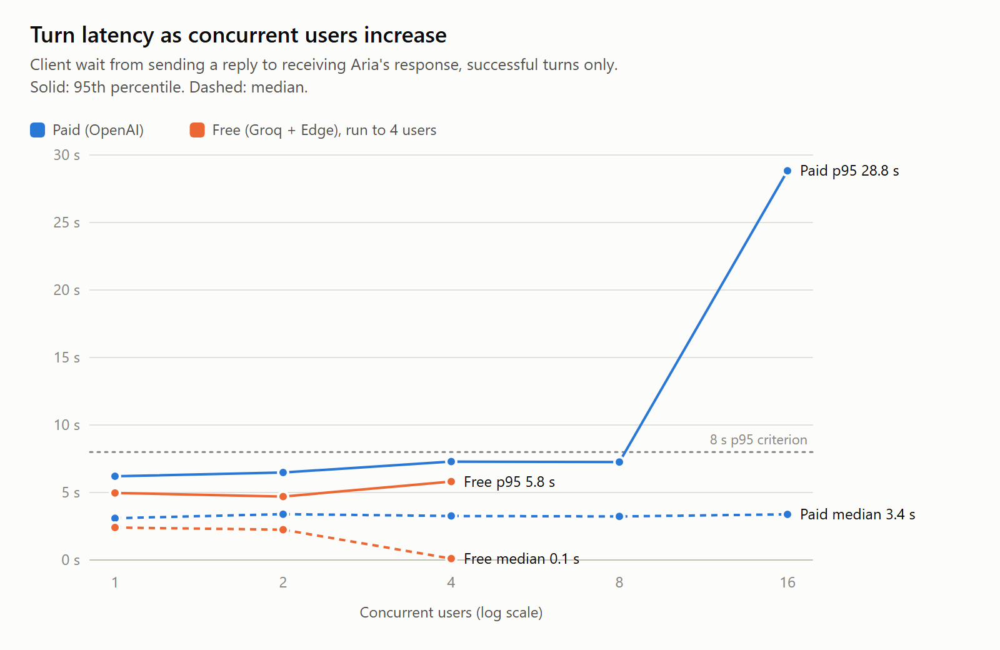
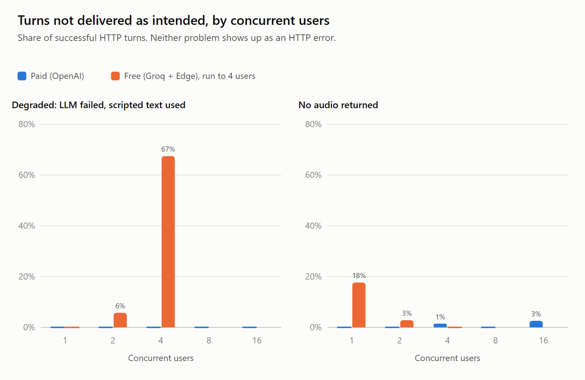
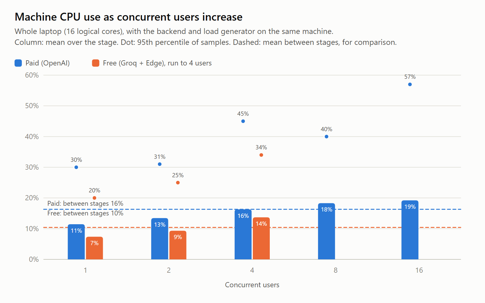
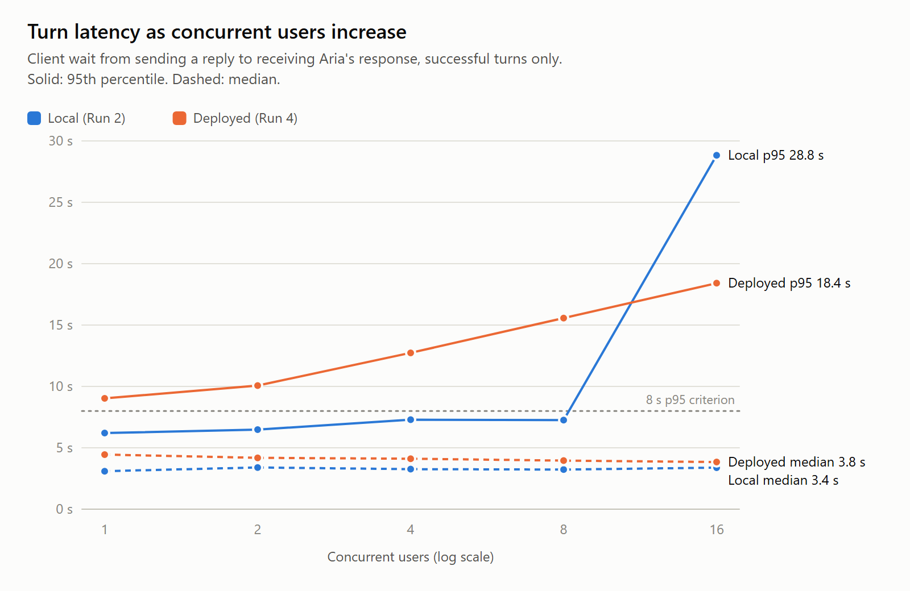
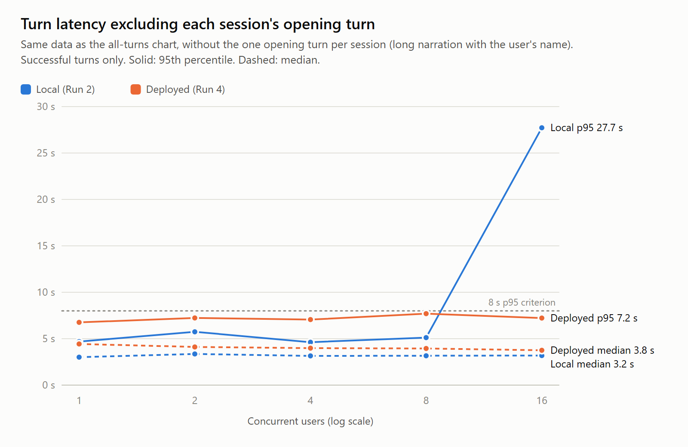
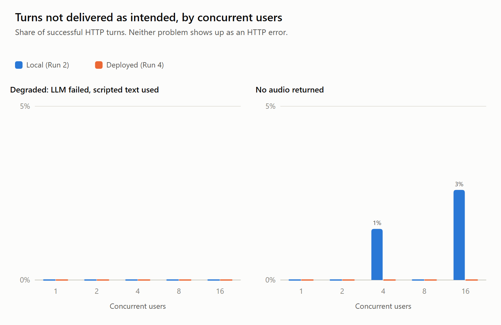

# Concurrent-user load test

`npm run eval:concurrency` measures how turn latency, errors and degraded responses change as more people use the app at the same time. It runs closed-loop virtual users: each one registers a synthetic account, starts Session 1, and plays it through the real API the way the browser does, waiting between turns as a person would. Users are added in stages (for example 1, 2, 4, 8), and each stage is summarised separately.

## Run

Point it at a backend you control: your local server, or a test deployment with its own database. Do not run it against the database real participants use. From `backend`:

```powershell
# Dry run: validates options and prints the plan without contacting the server
npm run eval:concurrency -- --api http://localhost:5000/api --levels 1,2,4,8

# Live run with stated pass criteria
npm run eval:concurrency -- --live --api http://localhost:5000/api --levels 1,2,4,8 --p95-ms 8000 --max-error-rate 0.02 --label "local-pilot-1"

# Afterwards, remove the run's accounts, sessions, messages and memory (dry run, then delete)
node scripts/cleanup-load-test.js --run RUNID
node scripts/cleanup-load-test.js --run RUNID --confirm
```

The cleanup script connects to `MONGO_URI` from `backend/.env`, so it must point at the same database as the server under test. `--all` matches every `loadtest-` account instead of one run.

To record server CPU and memory, run the sampler in a second terminal on the machine hosting the backend for the duration of the run, then copy its CSV into the run's results directory as `host-load.csv`:

```powershell
powershell -File scripts/sample-host-load.ps1 -OutFile host-load.csv
```

It samples every 2 seconds: whole-machine CPU and memory, the backend `node` process's CPU and memory, and the number and CPU of Rhubarb processes. Per-process CPU is a share of all logical cores.

To produce report figures and a markdown summary table from one or two runs (the second is drawn in the second series colour):

```powershell
node scripts/plot-concurrency.js --run "Paid (OpenAI)=evaluation/results/RUN_A" --run "Free (Groq + Edge)=evaluation/results/RUN_B"
```

This writes `concurrency-latency`, `concurrency-quality` and `concurrency-cpu` as SVG and PNG, plus `concurrency-summary.json`, to `evaluation/figures/`. Host load is joined to each stage by the stage's time window (first request start to last response).

Start with `--levels 1,2` to check connectivity and cost before going higher. Each virtual user completes a full Session 1 (about 13 turns), so a 1,2,4,8 run is 16 sessions (including warmup) and roughly 200 LLM-backed turns.

## What a virtual user does

1. Registers `loadtest-<run>-<n>` with a random password and a common first name (from a list of 50, so Session 1's name lines aren't all one cached TTS entry). Registration happens before the stage clock starts and is not measured.
2. Creates a Session 1 session (`cst_intro_reminiscence`; new accounts can only start Session 1).
3. Sends the opening turn (empty content, as the browser does), then replies from [concurrency-inputs.json](concurrency-inputs.json), which maps each slide ID to the replies to give there, in order. Keying by slide means a retried or follow-up question (such as Aria asking which version of a song) uses that slide's next reply without shifting later answers. Spotify, YouTube and auto-advance slides are completed with the same `[[...]]` events the browser posts. When a slide's replies run out it answers "I'm happy to keep going."
4. After each turn it downloads the generated audio, waits an estimated listening time (words ÷ 2.5 per second), then waits a random think time before replying.
5. It stops when the session completes, after `--max-turns`, at the first failed turn, or when the same slide has taken more than 6 turns in a row (`stuck`, reported per stage with the slide ID, so the reply file can be fixed). A timed-out turn may still be running on the server, so no further turns are sent to that session.

Sessions are not ended with `/end` (the browser doesn't do this when a script completes), so no background summary generation is triggered.

## Options

| Option | Default | Meaning |
|---|---|---|
| `--levels` | `1,2,4` | Concurrent users per stage (1–200 each). Each stage uses fresh accounts. |
| `--think-ms` | `2000-6000` | Uniform random pause after listening, before the next reply. `0` disables it. |
| `--skip-listen` | off | Don't wait for estimated speech duration. With `--think-ms 0`, users fire turns back to back (a stress test, not realistic use). |
| `--ramp-ms` | `5000` | Spread each stage's user starts evenly across this window. `0` starts everyone at once. |
| `--cooldown-ms` | `15000` | Pause between stages so in-flight prefetches settle. |
| `--skip-warmup` | off | By default one user runs a full session first (excluded from results) so every stage starts with a warm speech cache. |
| `--avatar`, `--lipsync` | `male`, `rhubarb` | Matches the app default. `--avatar visualizer --lipsync energy` skips Rhubarb. |
| `--pipeline` | server default | Requested pipeline; the server only honours modes it allows. |
| `--skip-audio-download` | off | Don't fetch generated audio files. |
| `--max-turns` | `40` | Per-session safety cap. |
| `--timeout-ms` | `120000` | Per-request timeout. |
| `--p95-ms`, `--max-error-rate`, `--max-degraded-rate` | unset | Pass criteria checked per stage. Unset criteria are not checked. |
| `--stop-error-rate` | `0.5` | Skip higher stages once a stage's turn error rate reaches this. |
| `--inputs`, `--label`, `--out` | | Reply list, free-text run label, results directory. |

## Outputs

Each run writes a unique ignored directory under `evaluation/results/*-concurrency-*/`:

- `manifest.json`: options, criteria, the server's `/sessions/pipeline` response, run ID and username prefix, completion time.
- `rows.jsonl`: one row per session creation and turn, appended as it happens, including warmup and failures.
- `samples.csv`: rows flattened with server stage timings.
- `stages.csv`: one row per stage with the summary metrics below.
- `report.json`: everything above together.

Per-stage metrics:

| Metric | Meaning |
|---|---|
| `requestLatency` (p50/p95/p99/max) | Client POST to parsed JSON for successful turns. This is the time the patient waits after replying, before audio download and playback. |
| `serverTotal`, `orchestrator`, `audioWait` | Server-reported stage durations (see [DEPLOYED-LATENCY.md](DEPLOYED-LATENCY.md#3-server-timing-interpretation)). Compare them with `requestLatency` to see whether time goes to server work or queueing in front of it. |
| `errorRate`, `timeouts`, `httpStatus` | Failed turns ÷ attempted turns, with status counts (429 and 5xx are the usual signs of overload). |
| `degradedTurns`, `degradedRate` | Successful turns where an LLM call failed and the orchestrator substituted scripted text (`timings.llmFallbacks > 0`). These look like successes over HTTP but aren't the adaptive response. `null` if the server predates this field. |
| `missingAudio`, `audioFetchFailures` | Turns with no speech, or whose audio files couldn't be downloaded. |
| `throughputTurnsPerMin` | Successful turns per minute of stage wall time. |
| `peakInFlight`, `meanInFlightAtStart` | How many requests were actually concurrent. With think time, N users produce far fewer than N simultaneous requests. |
| `speechCacheHits` | Segments served from the shared speech cache. |
| `criteria` | Which stated criteria a stage met, and the highest level where it and every lower level met them. |

## Interpreting results

This measures one deployment, from one client machine, under these settings. Report it as such: "at N concurrent users with think time T on deployment D, p95 turn latency was X ms and Y% of turns failed or degraded". The highest level meeting the criteria is a statement about the criteria you chose, not a general capacity figure.

Things that shape the numbers:

- **Provider quotas.** The LLM and TTS providers usually limit requests and tokens per minute per account. Rising 429s or `degradedRate` usually means quota, not server capacity. Note the account tier in the study record.
- **Rhubarb CPU.** Avatar modes spawn one Rhubarb process per uncached speech segment, with no limit on how many run at once. On a small instance this is often the first local bottleneck. Watch the backend host's CPU during the run (Task Manager locally, the host's metrics dashboard when deployed); this tool does not capture it.
- **Speech cache.** Scripted lines are synthesized once and shared across all users (up to 300 entries per process), as in production. Only fresh acknowledgements and name-bearing lines need new TTS. The warmup makes every stage start warm; restart the server and use `--skip-warmup` to measure cold-cache behaviour instead. Results only reflect a single backend process; multiple instances each have their own cache.
- **Same script and replies.** Every user runs Session 1 with the same replies, so the LLM prompt mix is narrower than real use. Other sessions require Session 1 to be completed first and aren't covered.
- **Typed input only.** Turns use `/respond`, so speech-to-text and audio upload are not exercised. Voice turns add STT time and STT provider quota on top.
- **Load generator.** At high levels, check that the client machine and network aren't the bottleneck (its CPU should be low, and `requestLatency - serverTotal` shouldn't grow by itself).
- **Side effects.** Runs create accounts, sessions, messages and pending memory suggestions, and write MP3s to the server's `generated-audio` folder. Clean up afterwards.

Turns within one session are dependent and stages run in sequence on the same server, so treat stage summaries as descriptive measurements, not independent samples. No confidence intervals or significance tests are computed. Repeat runs to see variability between them.

## Results

### Summary

Four runs on 13–17 October 2026, each with simulated users completing Session 1 through the real API. Runs 1–3 ran against a backend on the same laptop as the load generator; Run 4 ran against the deployed backend on a university server.

| | Free pipeline, local (Run 3) | Paid pipeline, local (Run 2) | Paid pipeline, deployed (Run 4) |
|---|---|---|---|
| Levels tested | 1, 2, 4 users | 1, 2, 4, 8, 16 users | 1, 2, 4, 8, 16 users |
| Highest level at which it and all lower levels met the stated criteria | 1 user | 8 users | None (p95 above 8 s from 1 user) |
| Degraded turns (LLM replaced by scripted text) by level | 0% (1), 5.7% (2; 2 of 35), 67.4% (4; 58 of 86) | 0% at every level | 0% at every level |
| Turns with no audio by level | 17.6% (1), 2.9% (2), 0% (4) | 0%, 0%, 1.5%, 0%, 2.6% | 0% at every level |
| Median / p95 turn latency by level, all turns | 2.4 / 5.0 s, 2.2 / 4.7 s, 0.1 / 5.8 s | 3.1 / 6.2 s, 3.4 / 6.5 s, 3.3 / 7.3 s, 3.2 / 7.3 s, 3.4 / 28.8 s | 4.4 / 9.0 s, 4.2 / 10.1 s, 4.1 / 12.7 s, 4.0 / 15.6 s, 3.8 / 18.4 s |
| p95 turn latency by level, excluding each session's opening turn | not computed | 4.7, 5.7, 4.6, 5.1, 27.7 s | 6.8, 7.2, 7.1, 7.7, 7.2 s |
| HTTP errors | 0 at every level | 0 at every level | 0 at every level |
| Observed at the first level not meeting the criteria | 4 users: 60 Groq `429` rejections logged in the run, 54 for the 200,000 tokens-per-day limit and 6 for the 8,000 tokens-per-minute limit | 16 users: OpenAI TTS time for new speech rose to a median of 12.2 s (1.4–1.7 s at 1–8 users); 7 turns reached the 30 s TTS timeout. Cause not identified. | 1 user: the session's opening turn took 15.1 s. Across the run, 31 of the 35 turns over 8 s were opening turns (median 15.1–19.9 s by level). |
| Machine CPU, stage means | 7–14% (laptop) | 11–19% (laptop) | Not recorded |

Run 1 (free pipeline, 1–2 users, before the Edge TTS library fix) is reported separately below as a pilot.

- **Criteria.** The pass criteria (p95 ≤ 8 s, HTTP errors ≤ 2%, degraded turns ≤ 5%) were chosen by the authors for this test; they are not taken from a published standard. "Highest level meeting the criteria" depends entirely on them. Per-stage results are given in full so other thresholds can be applied.
- **Comparability.** The runs are not a controlled comparison. Runs 2 and 3 differ in LLM and TTS provider, in the levels tested (Run 3 stopped at 4 users), and in order (Run 3 ran immediately after Run 2 on the same server process); Run 3 also reached Groq's daily token limit partway through, so its 4-user result reflects the daily limit as well as concurrency. Runs 2 and 4 use the same pipeline and application code but differ in server hardware, network path (Run 4 went through a Cloudflare tunnel), server mode (development vs production) and date, and provider conditions on the day may have differed.
- **Opening turns.** Each session's first turn speaks a long welcome that includes the user's name, so its audio cannot be shared from the speech cache. One opening turn per session is about 6% of turns, which is enough on its own to set the p95. In Run 4, opening turns took 15.1–19.9 s (median by level) against 6.3–7.9 s at 1–8 users in Run 2; other turns had a p95 of 6.8–7.7 s at every level.
- **The 16-user TTS slowdown in Run 2 did not recur in Run 4.** In Run 4, median TTS time for new speech stayed at 1.3–1.5 s at every level, including 16 users.
- **Failures not shown as HTTP errors.** Degraded turns and turns without audio both returned normal HTTP responses. Degraded turns also had lower latency than other turns (Run 3 at 4 users: median 93 ms against 1.9 s), which lowered the stage medians.
- **Free pipeline at 2 users.** Both sessions completed in each run. Degraded turns were 2 of 35 (5.7%) in Run 3 and 3 of 36 (8.3%) in Run 1, all following Groq `429` responses. In Run 3, one fewer degraded turn (1 of 35, 2.9%) would have met the 5% criterion.
- **Free pipeline daily limit.** Groq reported a limit of 200,000 tokens per day for `openai/gpt-oss-120b`. In Run 3 it was reached after the warmup, 1-user and 2-user stages (4 Session 1 sessions, 69 turns).
- **Local resources (Runs 2 and 3).** No sustained CPU or memory saturation was observed on the laptop at the levels tested: stage-mean machine CPU stayed at or below 19%, and the backend process stayed below 125 MB. Brief samples reached 100% CPU during bursts of Rhubarb processes. Server CPU was not recorded in Run 4.
- All results come from one run per level; see each run's limitations.

**Project decision (not a finding).** The free pipeline was adopted to prototype the app without cost. Given the provider limits measured here, the project treats it as a development and testing path, and further capacity work uses the paid pipeline.

Figures, regenerated with `scripts/plot-concurrency.js`. Paid and free pipelines, local (Runs 2 and 3):







Paid pipeline, local and deployed (Runs 2 and 4):







### Run 1: local smoke test, free pipeline, 1 and 2 users (13 October 2026)

This run checked that the tool works end to end and showed what limits the free pipeline first. It is a single short run with small samples (17 and 36 turns), so treat the figures as a pilot, not a capacity estimate.

**Setup**

| | |
|---|---|
| Run ID / results | `ac377a1d` / `evaluation/results/2026-10-13T03-33-10-326Z-concurrency-ac377a1d/` |
| Code | `feat/concurrency-eval` branched from `12c935d`, with this tool's uncommitted changes |
| Server and client | Same Windows 11 laptop (Intel Core Ultra 9 285H, 16 cores, 31 GB RAM), Node v24.14.0, local MongoDB. No network between client and server. |
| Pipeline | `free`: Groq `openai/gpt-oss-120b` (free `on_demand` tier), Edge TTS `en-NZ-MitchellNeural`, Rhubarb lip sync (male avatar) |
| Load | Session 1, levels 1 and 2, warmup on, think time 2–6 s plus estimated listening time, 5 s ramp, 15 s cooldown |
| Stated criteria | p95 request latency ≤ 8,000 ms, turn error rate ≤ 2%. Degraded rate was not set as a criterion. |

**Results**

| Metric | 1 user | 2 users |
|---|---|---|
| Sessions completed / failed / stuck | 1 / 0 / 0 | 2 / 0 / 0 |
| Turns attempted (all HTTP successes) | 17 | 36 |
| Request latency p50 / p95 / max | 1,733 / 4,171 / 4,973 ms | 1,235 / 6,320 / 9,629 ms |
| Server total p50 / p95 | 1,731 / 4,166 ms | 1,232 / 6,316 ms |
| Orchestrator (incl. LLM) p50 / p95 | 544 / 1,114 ms | 448 / 1,045 ms |
| Waiting for speech audio p50 / p95 | 917 / 3,425 ms | 771 / 5,962 ms |
| Degraded turns (LLM fallback) | 0 of 17 (0%) | 3 of 36 (8.3%) |
| Turns with no audio | 7 of 17 (41%) | 9 of 36 (25%) |
| Speech cache hits (segments) | 13 | 45 |
| Throughput | 2.9 turns/min | 5.4 turns/min |
| Peak / mean requests in flight | 1 / 1.00 | 2 / 1.11 |
| Stated criteria | Met | Met |

**What the data shows**

- **Speech generation accounted for most of the wait.** At the p95, waiting for speech (TTS plus Rhubarb) was 3.4 s of 4.2 s at 1 user and 6.0 s of 6.3 s at 2 users, while the orchestrator step stayed around 1 s. Median per-request TTS time was 1.0 s (1 user) and 1.4 s (2 users); median Rhubarb time was 0.5 s and 0.8 s. These medians come from 13–19 and 6–10 synthesized requests respectively, so they are rough.
- **Request latency matched server time.** Request and server-total latency differed by under 5 ms, as expected with the client and server on one machine. Audio downloads took a median of 3–5 ms locally; on a real deployment they would be longer.
- **Edge TTS rejected requests.** About a third of turns across both stages (16 of 53) returned no audio. In the backend log, every TTS failure during the run was an Edge TTS `403` response, including at 1 user, so this was not caused by concurrency. `ttsService.js` makes one attempt per segment with no retry. Investigated on 15 October: by then Edge rejected every request from the installed `msedge-tts` 2.0.5 (20 of 20 sequential and 20 of 20 at 4 in parallel). `msedge-tts` 2.1.0, released 13 October, retries a 403 handshake once using the server's clock, and succeeded on 20 of 20 sequential requests. The app now uses 2.1.0, and `ttsService.js` also closes each Edge connection after use (previously one WebSocket was left open per synthesized segment).
- **Degraded turns followed Groq rate-limit responses.** All 3 degraded turns at 2 users followed Groq `429` responses for the 8,000 tokens-per-minute limit; each rejected request asked for 2,300–2,900 tokens, which allows roughly 3 LLM requests per minute across all users. When an LLM call fails, the app substitutes scripted text and returns a normal response.
- **Failed turns had lower latency.** Turns with no audio had a median latency of 1,259 ms (n = 16), against 1,991 ms with audio (n = 37). Degraded turns had a median of 121 ms (n = 3), against 1,306 ms for the rest. The latency figures above include these turns. Error rate was 0% throughout, because neither failure produces an HTTP error.
- **Requests rarely overlapped at 2 users.** With think time, the two users had a request in flight together only occasionally (mean 1.11 in flight when a request started).

**Limitations of this run**

- One run per level, small samples, client and server on the same machine; no repeat runs to show variability.
- Server CPU and memory were not recorded.
- The p95/max at 2 users rests on 36 turns, so one or two slow turns move it substantially.
- Missing audio and degraded turns were not excluded or corrected, so the latency figures mix normal and failed turns.
- Typed input only: speech-to-text was not exercised.

**Follow-up.** This run led to the Edge TTS fix described above, the free-tier limit measurements below, and Runs 2 and 3.

### Run 2: paid pipeline (OpenAI), 1 to 16 users (15–16 October 2026)

**Setup**

| | |
|---|---|
| Run ID / results | `8174e113` / `evaluation/results/2026-10-15T10-31-35-894Z-concurrency-8174e113/` (includes `host-load.csv`) |
| Code | `feat/concurrency-eval` branched from `12c935d`, uncommitted, including the `msedge-tts` 2.1.0 upgrade (not used by this pipeline) |
| Server and client | Same laptop as Run 1, plugged in, with Chrome, Discord and Battle.net closed (10.9 GB of 31.5 GB memory in use before the run). VS Code open. |
| Pipeline | `openai-fast-scripted`: OpenAI `gpt-5.4-mini` (Responses API), OpenAI TTS `gpt-4o-mini-tts` voice `alloy`, Rhubarb lip sync (male avatar) |
| Load | Session 1, levels 1, 2, 4, 8, 16, warmup on, think time 2–6 s plus estimated listening time, 5 s ramp, 15 s cooldown |
| Stated criteria | p95 request latency ≤ 8,000 ms, turn error rate ≤ 2%, degraded rate ≤ 5% |

**Results**

| Users | Sessions completed | Turns | HTTP errors | Median | p95 | Max | Turns over 8 s | Degraded | No audio | Turns/min | Mean in flight | Machine CPU mean / p95 | Criteria |
|---|---|---|---|---|---|---|---|---|---|---|---|---|---|
| 1 | 1 of 1 | 16 | 0 | 3.1 s | 6.2 s | 6.3 s | 0% | 0% | 0% | 2.6 | 1.00 | 11% / 30% | Met |
| 2 | 2 of 2 | 34 | 0 | 3.4 s | 6.5 s | 7.4 s | 0% | 0% | 0% | 5.1 | 1.18 | 13% / 31% | Met |
| 4 | 4 of 4 | 68 | 0 | 3.3 s | 7.3 s | 31.1 s | 4.4% | 0% | 1.5% (1) | 9.9 | 1.50 | 16% / 45% | Met |
| 8 | 8 of 8 | 137 | 0 | 3.2 s | 7.3 s | 10.2 s | 1.5% | 0% | 0% | 19.9 | 2.33 | 18% / 40% | Met |
| 16 | 16 of 16 | 270 | 0 | 3.4 s | **28.8 s** | 51.2 s | **43.7%** | 0% | 2.6% (7) | 29.0 | 5.61 | 19% / 57% | **Not met** (p95) |

Highest level where it and every lower level met the stated criteria: **8 users**.

Where the time went, for successful turns (server-reported; TTS figures cover only turns that synthesized new speech rather than reusing cached audio):

| Users | Orchestrator (incl. LLM) median / p95 | TTS median / p95 | Turns that synthesized speech | Rhubarb median / p95 |
|---|---|---|---|---|
| 1 | 1.3 / 1.7 s | 1.4 / 4.1 s | 12 | 0.6 / 2.0 s |
| 2 | 1.2 / 1.8 s | 1.6 / 4.4 s | 26 | 0.6 / 1.8 s |
| 4 | 1.2 / 1.7 s | 1.5 / 3.3 s | 46 | 0.6 / 1.9 s |
| 8 | 1.2 / 1.7 s | 1.7 / 3.6 s | 82 | 0.6 / 2.0 s |
| 16 | 1.2 / 1.7 s | **12.2 / 29.9 s** | 144 | 0.6 / 1.9 s |

**What the data shows**

- **From 1 to 8 users, latency was flat.** Median turn latency stayed between 3.1 and 3.4 s and p95 between 6.2 and 7.3 s while the number of users rose eightfold. No turn failed over HTTP and no LLM call fell back to scripted text at any level.
- **At 16 users, OpenAI TTS time increased and the p95 rose to 28.8 s.** The median TTS time for turns that needed new speech rose from 1.4–1.7 s (1–8 users) to 12.2 s, with a p95 of 29.9 s, against the app's 30 s TTS timeout. 7 turns (2.6%) hit that timeout and returned no audio. Over the same range, orchestrator time (which includes the LLM call) and Rhubarb time did not change.
- **Median and tail diverged at 16 users.** Turns whose speech was already cached (scripted narration shared across users) returned quickly, keeping the median at 3.4 s, while 118 of 270 turns (43.7%) took longer than 8 s.
- **No sustained CPU or memory saturation was observed.** Mean machine CPU rose from 11% (1 user) to 19% (16 users), against 16% mean between stages, with short peaks reaching 100% at 8 and 16 users. Every sample at or above 80% had 2–7 Rhubarb processes running, and these samples clustered in two bursts of under a minute, at about the start of the 8- and 16-user stages, when users' opening turns arrive close together. The backend Node process's memory rose from 106 MB to 123 MB. These figures include the load generator and other programs on the same machine.
- **The cause of the TTS slowdown was not identified.** No HTTP 429 (rate limit) responses were logged; requests became slow rather than rejected. Possible explanations, none tested, include OpenAI account-tier throughput limits for the TTS model, provider-side queueing, and client-side connection handling in the backend.
- **Requests in flight stayed well below the user count.** With think time, 16 users averaged 5.6 requests in flight when a request started (peak 16). Throughput rose with users up to 8 (19.9 turns/min) but grew less than proportionally at 16 (29.0 turns/min), as slow turns delayed each user's next reply.

**Limitations of this run**

- One run per level, with no repeats to show run-to-run variation. Larger stages contribute more turns (16 users: 270) than small ones (1 user: 16), so the 1- and 2-user percentiles are less precise.
- Client and server on the same laptop, so no real network latency or audio download time is included, and machine CPU includes the load generator.
- The CPU sampler's first version assumed a 2 s interval between samples, but each sample took about 3.4 s. Per-process CPU in this run's `host-load.csv` was rescaled by the measured interval in `plot-concurrency.js`; machine-wide CPU was unaffected. Short-lived Rhubarb processes are mostly missed by per-process sampling, so only machine-wide CPU is reported.
- Typed input only (no speech-to-text), Session 1 only, and identical replies for every user.
- The between-stage comparison samples (n = 23) were taken during cooldowns, when background speech prefetches may still be running, so they are not a true idle baseline.

### Run 3: free pipeline (Groq + Edge TTS), 1 to 4 users (16 October 2026)

Run immediately after Run 2 on the same server process and machine, with the fixed Edge TTS library.

**Setup**

| | |
|---|---|
| Run ID / results | `27f4b122` / `evaluation/results/2026-10-15T11-16-13-349Z-concurrency-27f4b122/` (includes `host-load.csv`) |
| Code | As Run 2 (`msedge-tts` 2.1.0, Edge connections closed after use) |
| Pipeline | `free`: Groq `openai/gpt-oss-120b` (free `on_demand` tier), Edge TTS `en-NZ-MitchellNeural`, Rhubarb lip sync (male avatar) |
| Load | Session 1, levels 1, 2, 4, warmup on, otherwise as Run 2 |
| Stated criteria | As Run 2 |

**Results**

| Users | Sessions completed | Turns | HTTP errors | Median | p95 | Max | Degraded | No audio | Turns per session | Machine CPU mean / p95 | Criteria |
|---|---|---|---|---|---|---|---|---|---|---|---|
| 1 | 1 of 1 | 17 | 0 | 2.4 s | 5.0 s | 6.0 s | 0% | 17.6% (3) | 17.0 | 7% / 20% | Met |
| 2 | 2 of 2 | 35 | 0 | 2.2 s | 4.7 s | 6.3 s | 5.7% (2) | 2.9% (1) | 17.5 | 9% / 25% | **Not met** (degraded) |
| 4 | 4 of 4 | 86 | 0 | **0.1 s** | 5.8 s | 6.8 s | **67.4% (58)** | 0% | 21.5 | 14% / 34% | **Not met** (degraded) |

Highest level where it and every lower level met the stated criteria: **1 user**. At 2 users, 2 of 35 turns were degraded (5.7%); 1 of 35 (2.9%) would have met the criterion. Both 2-user sessions completed.

**What the data shows**

- **The LLM was replaced by scripted text for two-thirds of turns at 4 users.** The backend log recorded 60 Groq `429` rejections during the run, one per degraded turn: 54 for the 200,000 tokens-per-day limit and 6 for the 8,000 tokens-per-minute limit. The first daily-limit rejection reported 199,033 of 200,000 tokens already used, with "try again in 12m22s" (consistent with a rolling window rather than a fixed daily reset; not verified). The only other known Groq use on this API key in the preceding 24 hours was two probe calls of under 100 tokens each, so the run's own warmup, 1-user and 2-user stages (4 sessions, 69 turns) used nearly the whole daily allowance. The log has no timestamps, so rejections cannot be assigned to stages exactly; degraded turns were 2 at 2 users and 58 at 4 users.
- **Degraded turns had lower latency.** At 4 users, degraded turns had a median latency of 93 ms against 1.9 s for turns that reached the LLM, so the stage median was 0.1 s. The p95 stayed under 8 s at every level.
- **Degraded sessions were longer.** Sessions averaged 21.5 turns at 4 users against 17.0–17.5 at 1–2 users, so the scripted fallback appears to ask more follow-up or retry questions than the adaptive path. This was not investigated further.
- **Edge TTS returned no audio for 3 of 17 turns at 1 user.** All failures logged in the run were Edge `429 Too Many Requests` responses (6 turns, plus 3 background prefetches), not the earlier `403`s. With fewer synthesis requests needed at 4 users (most turns used cached narration), no audio was lost there.
- **No sustained CPU or memory saturation was observed.** Mean machine CPU was 7–14%, and the backend process used under 115 MB of memory.

**Limitations of this run**

- The daily token limit was reached partway through, so this run cannot separate per-minute from per-day limits at each level. A run on a fresh daily allowance would show per-minute limits alone, but the daily allowance would still cap total use at roughly 4–5 Session 1 sessions a day.
- Run immediately after Run 2, so Edge's own rate limiting may have been influenced by earlier probe requests that day.
- The same general limitations as Run 2 apply (single run, same machine, typed input, Session 1 only).

### Run 4: paid pipeline (OpenAI), deployed backend, 1 to 16 users (17 October 2026)

**Setup**

| | |
|---|---|
| Run ID / results | `6de93df7` / `evaluation/results/2026-10-17T02-56-45-746Z-concurrency-6de93df7/` |
| Target | The deployed backend, reached through a Cloudflare quick tunnel (`*.trycloudflare.com`). Its `/sessions/pipeline` endpoint reported production mode (only `openai-fast-scripted` available), with Rhubarb available. |
| Server | University computer: 2 × Intel Xeon Gold 6130 @ 2.10 GHz (32 cores), 256 GB RAM, Linux (distribution not recorded). Other workloads on the machine during the run were not recorded. |
| Code | `main`, reported by the project team as the deployed version (`ffec729` at the time of the run); the backend's responses included the `llmFallbacks` field added in that version |
| Database | The production database, which at the time held only project team accounts (no participants). The run's accounts use the prefix `loadtest-6de93df7-`. |
| Client | The same laptop as Runs 1–3, over the internet |
| Pipeline | `openai-fast-scripted`: OpenAI `gpt-5.4-mini`, OpenAI TTS `gpt-4o-mini-tts` (voice per the server's configuration, not recorded), Rhubarb lip sync (male avatar) |
| Load and criteria | As Run 2: levels 1, 2, 4, 8, 16, warmup on, think time 2–6 s plus estimated listening time, 5 s ramp, 15 s cooldown; p95 ≤ 8 s, errors ≤ 2%, degraded ≤ 5% |

**Results**

| Users | Sessions completed | Turns | HTTP errors | Median | p95 | Max | Turns over 8 s | Degraded | No audio | Turns/min | Mean in flight | Criteria |
|---|---|---|---|---|---|---|---|---|---|---|---|---|
| 1 | 1 of 1 | 17 | 0 | 4.4 s | 9.0 s | 15.1 s | 5.9% (1) | 0% | 0% | 2.3 | 1.00 | **Not met** (p95) |
| 2 | 2 of 2 | 34 | 0 | 4.2 s | 10.1 s | 15.9 s | 5.9% (2) | 0% | 0% | 4.7 | 1.15 | **Not met** (p95) |
| 4 | 4 of 4 | 67 | 0 | 4.1 s | 12.7 s | 16.7 s | 6.0% (4) | 0% | 0% | 9.4 | 1.75 | **Not met** (p95) |
| 8 | 8 of 8 | 134 | 0 | 4.0 s | 15.6 s | 18.6 s | 9.0% (12) | 0% | 0% | 19.1 | 2.99 | **Not met** (p95) |
| 16 | 16 of 16 | 268 | 0 | 3.8 s | 18.4 s | 25.7 s | 6.0% (16) | 0% | 0% | 36.7 | 3.90 | **Not met** (p95) |

Highest level where it and every lower level met the stated criteria: **none**.

Opening turns and other turns, by level:

| Users | Opening turns: n, median, max | Other turns: n, median, p95, max, over 8 s |
|---|---|---|
| 1 | 1, 15.1 s, 15.1 s | 16, 4.4 s, 6.8 s, 7.5 s, 0 |
| 2 | 2, 15.2 s, 15.9 s | 32, 4.1 s, 7.2 s, 7.7 s, 0 |
| 4 | 4, 15.7 s, 16.7 s | 63, 4.0 s, 7.1 s, 7.2 s, 0 |
| 8 | 8, 16.3 s, 18.6 s | 126, 3.9 s, 7.7 s, 8.7 s, 4 |
| 16 | 16, 19.9 s, 25.7 s | 252, 3.8 s, 7.2 s, 7.9 s, 0 |

For comparison, Run 2 (local) opening turns had medians of 6.3, 6.7, 7.9, 7.5 and 14.6 s at 1, 2, 4, 8 and 16 users.

Where the time went, for successful turns (server-reported; TTS and Rhubarb figures cover only turns that synthesized new speech):

| Users | Orchestrator (incl. LLM) median / p95 | TTS median / p95 | Turns that synthesized speech | Rhubarb median / p95 | Client time outside the server, median | Audio download, median |
|---|---|---|---|---|---|---|
| 1 | 1.2 / 2.5 s | 1.5 / 3.5 s | 14 | 1.6 / 5.3 s | 142 ms | 416 ms |
| 2 | 1.0 / 1.8 s | 1.4 / 3.2 s | 24 | 1.6 / 5.9 s | 140 ms | 405 ms |
| 4 | 1.0 / 1.7 s | 1.4 / 2.6 s | 44 | 1.6 / 6.1 s | 140 ms | 368 ms |
| 8 | 1.0 / 1.5 s | 1.3 / 2.7 s | 86 | 1.6 / 6.6 s | 120 ms | 340 ms |
| 16 | 1.0 / 1.4 s | 1.3 / 2.7 s | 149 | 1.6 / 6.5 s | 107 ms | 335 ms |

"Client time outside the server" is client-measured latency minus the server's reported handling time: network transfer, the tunnel and request parsing. Audio download is not included in the latency figures.

**What the data shows**

- **No HTTP errors, degraded turns or missing audio at any level.** All 31 sessions completed.
- **p95 latency was above 8 s at every level, set by the opening turns.** Opening turns took a median of 15.1 s at 1 user, rising to 19.9 s at 16 users. With one opening turn per session (about 6% of turns), the p95 falls among them. Of the 35 turns over 8 s across the run, 31 were opening turns.
- **Other turns stayed under 8 s at the p95 at every level.** Excluding opening turns, the p95 was 6.8–7.7 s from 1 to 16 users and the median 3.8–4.4 s, with 4 of 489 such turns over 8 s (all at 8 users).
- **Opening turns spent their time waiting for speech.** Their server time was almost all spent waiting for audio (about 14–16 s at 1–4 users), against orchestrator times under 20 ms. Their audio was produced by a background prefetch, so separate TTS and Rhubarb times for that segment were not recorded.
- **Rhubarb took longer on this server than on the laptop.** For turns that synthesized speech, median Rhubarb time was 1.6 s at every level, against 0.6 s in Run 2, with p95 5.3–6.6 s against 1.8–2.0 s. The Xeon Gold 6130's base clock (2.1 GHz) is lower than the laptop processor's, which may contribute; this was not tested, and server CPU load was not recorded. Rhubarb median time did not change with the number of users.
- **TTS and LLM times did not change with load.** Median TTS time for new speech was 1.3–1.5 s and median orchestrator time 1.0–1.2 s at every level. The TTS slowdown seen at 16 users in Run 2 did not occur.
- **Network added a small, constant amount.** Client time outside the server was 107–142 ms per request (median), and audio downloads took 335–416 ms (median), neither increasing with users.
- **Throughput rose roughly in proportion to users**, from 2.3 turns/min at 1 user to 36.7 at 16, with 3.9 requests in flight on average at 16 users.

**Limitations of this run**

- Server CPU and memory were not recorded (no access to the machine during the run). Whether other workloads ran on it is not known.
- One run per level, on one day; OpenAI conditions on the day may differ from Run 2's.
- The Cloudflare quick tunnel is a development tool without service guarantees and may not represent the production network path.
- The opening turn's TTS and Rhubarb times were not recorded separately, so the split of its wait between the two is not known.
- The deployed TTS voice was not recorded; if it differs from Run 2's (`alloy`), speech length and synthesis time may differ.
- The same general limitations as Run 2 apply (typed input, Session 1 only, identical replies).

### Free-tier provider limits (measured 15 October 2026)

The free pipeline depends on two free services, Groq (LLM and speech-to-text) and Microsoft's Edge read-aloud endpoint (TTS). Both apply rate limits of their own, separate from the app's capacity.

**Groq: transcription has its own quota, separate from the LLM's.** Groq reports remaining quota in `x-ratelimit-*` response headers. One LLM call, then three Whisper transcriptions of a 1–2 second fixture (`evaluation/audio/02-gardening.wav`), then a second LLM call gave:

| Call | LLM requests left (of 1,000/day) | LLM tokens left (of 8,000/min) | Whisper requests left (of 2,000/day) | Whisper audio seconds left (of 7,200/hour) |
|---|---|---|---|---|
| LLM call 1 | 999 | 7,906 | | |
| Whisper calls 1–3 | | | 1,999 → 1,998 → 1,997 | 7,199 → 7,198 → 7,197 |
| LLM call 2 | 998 | 7,906 | | |

The LLM's request count fell by one, for the second LLM call itself; the transcriptions did not reduce it, and the LLM token allowance had fully refilled between calls. So transcription consumes Groq free-tier quota, but from its own per-model allowance (requests per day and audio seconds per hour), not the LLM's. Limits are per organization, shared by all API keys. What this means for the free tier:

- Each voice turn uses one Whisper request: at most 2,000 voice turns a day, and the published limit of 20 requests a minute caps voice turns across all users.
- The LLM limit of 8,000 tokens a minute, at the 2,300–2,900 tokens per request seen in Run 1's rate-limit errors, allows roughly 3 LLM requests a minute across all users.
- A daily token limit for the LLM is not reported in these headers, but Run 3 reached it: Groq's rejection reported a limit of 200,000 tokens per day, matching third-party summaries ([Groq rate limits](https://console.groq.com/docs/rate-limits), [third-party summary](https://localaimaster.com/blog/groq-api-free-guide)). At about 2,700 tokens per request that is roughly 75 LLM requests a day, which Run 3 used up in about 4 Session 1 sessions.
- `STT_PROVIDER=groq` in `.env` sends transcription to Groq even on the OpenAI pipeline, so the Whisper allowance applies there too.

**Edge TTS: throttles concurrent requests.** With `msedge-tts` 2.1.0, 20 sequential requests all succeeded (median 0.8 s each), but sending them 4 at a time gave 18 successes and 2 `429 Too Many Requests` rejections. After about 60 probe requests in total, later single requests were also rejected with 429 (2 of 6 sequential, then 1 of 1 a few minutes later). No published rate limits for this endpoint were found.

Automated tests ([concurrency.test.js](../src/evaluation/concurrency.test.js)) cover the virtual-user flow, stage concurrency, summaries and criteria with a mocked server. They are not a live measurement.
